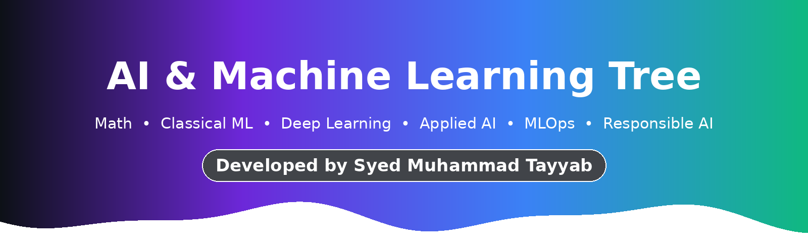
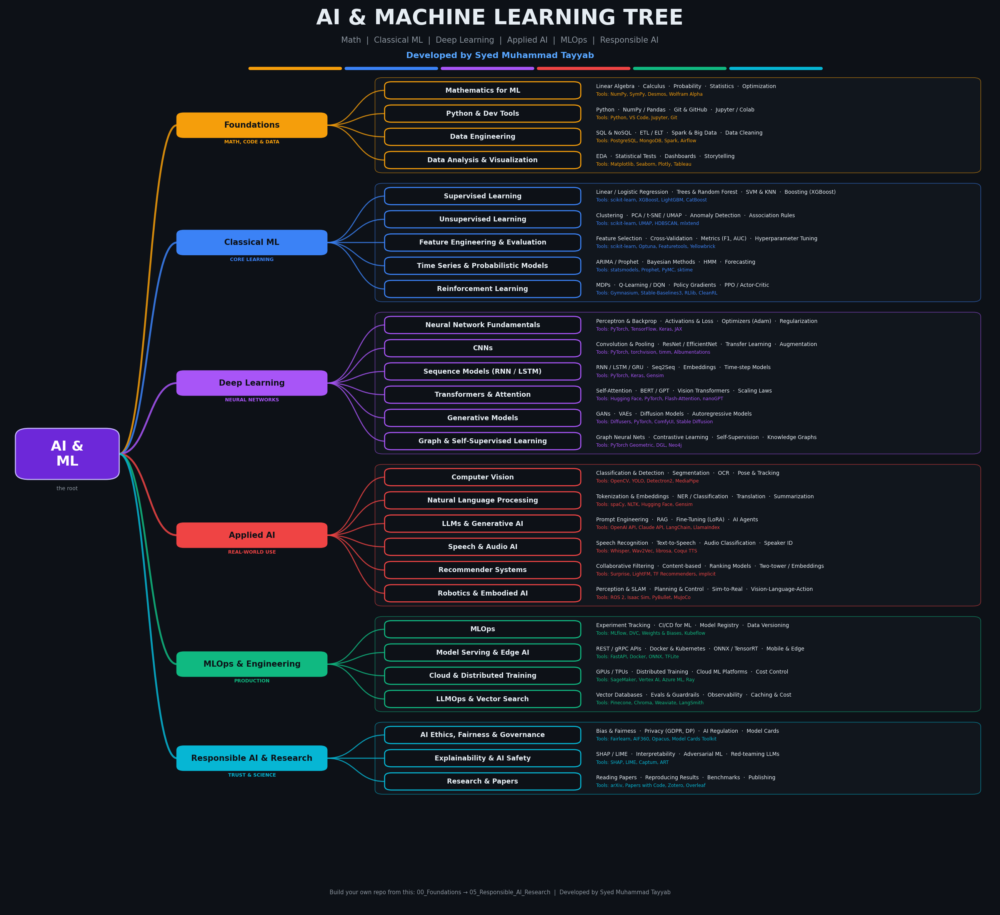
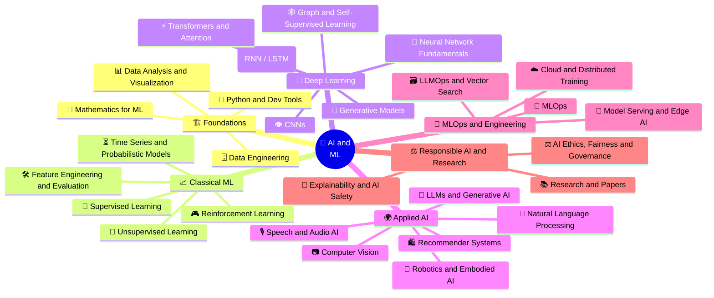
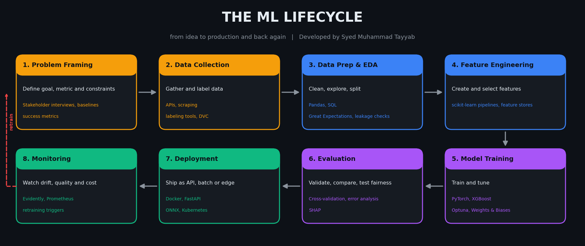
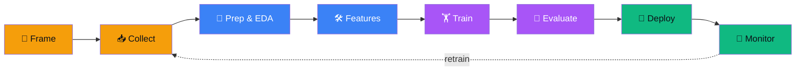
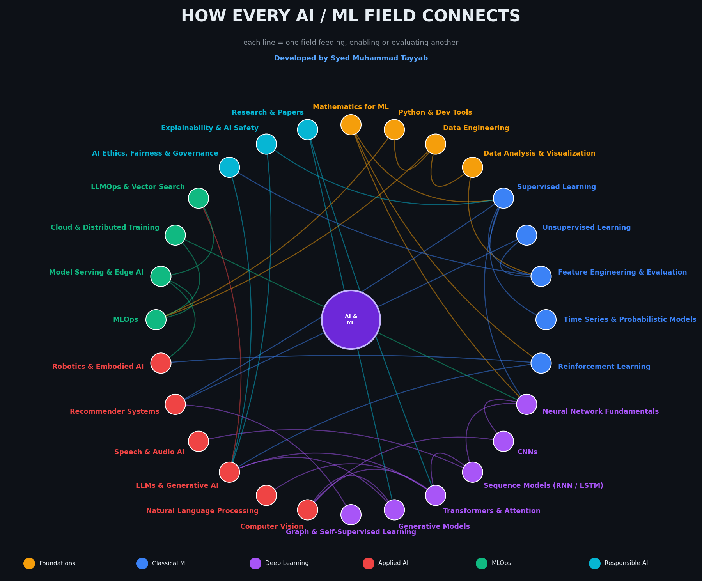
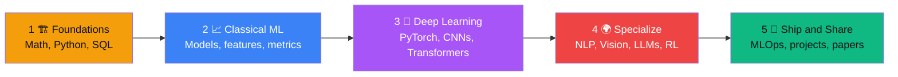
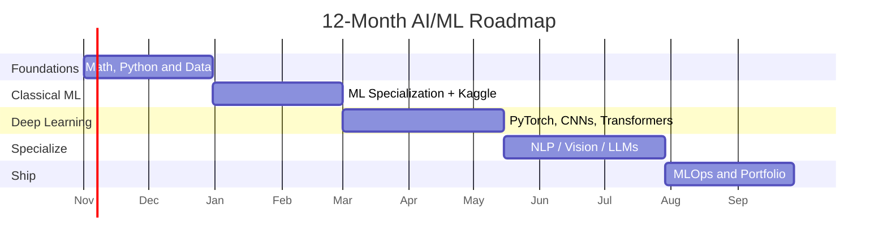

<div align="center">



<h3>✨ Developed by Syed Muhammad Tayyab ✨</h3>

<a href="https://github.com/Syed-Muhammad-Tayyab">
  
</a>

<br/>


<br/><br/>


<br/><br/>

<a href="#-the-big-picture"><b>🌴 Tree</b></a> &nbsp;•&nbsp; <a href="#-foundations--math-code--data"><b>🏗️ Foundations</b></a> &nbsp;•&nbsp; <a href="#-classical-ml--core-learning"><b>📈 Classical</b></a> &nbsp;•&nbsp; <a href="#-deep-learning--neural-networks"><b>🧠 Deep</b></a> &nbsp;•&nbsp; <a href="#-applied-ai--real-world-use"><b>🌍 Applied</b></a> &nbsp;•&nbsp; <a href="#-mlops--engineering--production"><b>🚀 MLOps</b></a> &nbsp;•&nbsp; <a href="#-responsible-ai--research--trust--science"><b>⚖️ Responsible</b></a> &nbsp;•&nbsp; <a href="#-how-everything-is-linked"><b>🔗 Links</b></a> &nbsp;•&nbsp; <a href="#-folder-structure"><b>📂 Folders</b></a> &nbsp;•&nbsp; <a href="#-learning--certification-roadmap"><b>🎓 Roadmap</b></a>

</div>

---

## 🌴 The Big Picture

<div align="center">
  
</div>

<div align="center">

| 🖼️ Picture | 📄 PDF Guide | 📊 Slides | 🔗 Link Map | 🔄 Lifecycle |
|:---:|:---:|:---:|:---:|:---:|
| [`aiml_tree.png`](assets/aiml_tree.png) | [`AIML_Tree.pdf`](docs/AIML_Tree.pdf) | [`AIML_Tree.pptx`](docs/AIML_Tree.pptx) | [`aiml_link_map.png`](assets/aiml_link_map.png) | [`aiml_lifecycle.png`](assets/aiml_lifecycle.png) |

</div>

### 🪆 AI ⊃ ML ⊃ DL ⊃ GenAI

| Layer | Meaning | Examples |
|:---|:---|:---|
| 🤖 **Artificial Intelligence** | Any technique that makes machines act intelligently | Search, planning, expert systems, ML |
| 📈 **Machine Learning** | Systems that learn patterns from data | Regression, random forest, XGBoost, clustering |
| 🧠 **Deep Learning** | ML with many-layered neural networks | CNNs, RNNs, Transformers |
| ✨ **Generative AI** | Models that create new content | LLMs, diffusion, GANs, code assistants |

### 🌳 Tree view

```text
🌴 AI & MACHINE LEARNING
├── 🏗️ FOUNDATIONS  (Math, Code & Data)
│   ├── 🧮 Mathematics for ML
│   │   ├── Linear Algebra
│   │   ├── Calculus
│   │   ├── Probability
│   │   ├── Statistics
│   │   └── Optimization
│   ├── 🐍 Python & Dev Tools
│   │   ├── Python
│   │   ├── NumPy / Pandas
│   │   ├── Git & GitHub
│   │   └── Jupyter / Colab
│   ├── 🗄️ Data Engineering
│   │   ├── SQL & NoSQL
│   │   ├── ETL / ELT
│   │   ├── Spark & Big Data
│   │   └── Data Cleaning
│   └── 📊 Data Analysis & Visualization
│       ├── EDA
│       ├── Statistical Tests
│       ├── Dashboards
│       └── Storytelling
├── 📈 CLASSICAL ML  (Core Learning)
│   ├── 🎯 Supervised Learning
│   │   ├── Linear / Logistic Regression
│   │   ├── Trees & Random Forest
│   │   ├── SVM & KNN
│   │   └── Boosting (XGBoost)
│   ├── 🧩 Unsupervised Learning
│   │   ├── Clustering
│   │   ├── PCA / t-SNE / UMAP
│   │   ├── Anomaly Detection
│   │   └── Association Rules
│   ├── 🛠️ Feature Engineering & Evaluation
│   │   ├── Feature Selection
│   │   ├── Cross-Validation
│   │   ├── Metrics (F1, AUC)
│   │   └── Hyperparameter Tuning
│   ├── ⏳ Time Series & Probabilistic Models
│   │   ├── ARIMA / Prophet
│   │   ├── Bayesian Methods
│   │   ├── HMM
│   │   └── Forecasting
│   └── 🎮 Reinforcement Learning
│       ├── MDPs
│       ├── Q-Learning / DQN
│       ├── Policy Gradients
│       └── PPO / Actor-Critic
├── 🧠 DEEP LEARNING  (Neural Networks)
│   ├── 🧠 Neural Network Fundamentals
│   │   ├── Perceptron & Backprop
│   │   ├── Activations & Loss
│   │   ├── Optimizers (Adam)
│   │   └── Regularization
│   ├── 👁️ CNNs
│   │   ├── Convolution & Pooling
│   │   ├── ResNet / EfficientNet
│   │   ├── Transfer Learning
│   │   └── Augmentation
│   ├── 🔁 Sequence Models (RNN / LSTM)
│   │   ├── RNN / LSTM / GRU
│   │   ├── Seq2Seq
│   │   ├── Embeddings
│   │   └── Time-step Models
│   ├── ⚡ Transformers & Attention
│   │   ├── Self-Attention
│   │   ├── BERT / GPT
│   │   ├── Vision Transformers
│   │   └── Scaling Laws
│   ├── 🎨 Generative Models
│   │   ├── GANs
│   │   ├── VAEs
│   │   ├── Diffusion Models
│   │   └── Autoregressive Models
│   └── 🕸️ Graph & Self-Supervised Learning
│       ├── Graph Neural Nets
│       ├── Contrastive Learning
│       ├── Self-Supervision
│       └── Knowledge Graphs
├── 🌍 APPLIED AI  (Real-World Use)
│   ├── 📷 Computer Vision
│   │   ├── Classification & Detection
│   │   ├── Segmentation
│   │   ├── OCR
│   │   └── Pose & Tracking
│   ├── 💬 Natural Language Processing
│   │   ├── Tokenization & Embeddings
│   │   ├── NER / Classification
│   │   ├── Translation
│   │   └── Summarization
│   ├── 🤖 LLMs & Generative AI
│   │   ├── Prompt Engineering
│   │   ├── RAG
│   │   ├── Fine-Tuning (LoRA)
│   │   └── AI Agents
│   ├── 🎙️ Speech & Audio AI
│   │   ├── Speech Recognition
│   │   ├── Text-to-Speech
│   │   ├── Audio Classification
│   │   └── Speaker ID
│   ├── 🛍️ Recommender Systems
│   │   ├── Collaborative Filtering
│   │   ├── Content-based
│   │   ├── Ranking Models
│   │   └── Two-tower / Embeddings
│   └── 🦾 Robotics & Embodied AI
│       ├── Perception & SLAM
│       ├── Planning & Control
│       ├── Sim-to-Real
│       └── Vision-Language-Action
├── 🚀 MLOPS & ENGINEERING  (Production)
│   ├── 🔄 MLOps
│   │   ├── Experiment Tracking
│   │   ├── CI/CD for ML
│   │   ├── Model Registry
│   │   └── Data Versioning
│   ├── 🚀 Model Serving & Edge AI
│   │   ├── REST / gRPC APIs
│   │   ├── Docker & Kubernetes
│   │   ├── ONNX / TensorRT
│   │   └── Mobile & Edge
│   ├── ☁️ Cloud & Distributed Training
│   │   ├── GPUs / TPUs
│   │   ├── Distributed Training
│   │   ├── Cloud ML Platforms
│   │   └── Cost Control
│   └── 🗃️ LLMOps & Vector Search
│       ├── Vector Databases
│       ├── Evals & Guardrails
│       ├── Observability
│       └── Caching & Cost
└── ⚖️ RESPONSIBLE AI & RESEARCH  (Trust & Science)
    ├── ⚖️ AI Ethics, Fairness & Governance
    │   ├── Bias & Fairness
    │   ├── Privacy (GDPR, DP)
    │   ├── AI Regulation
    │   └── Model Cards
    ├── 🔎 Explainability & AI Safety
    │   ├── SHAP / LIME
    │   ├── Interpretability
    │   ├── Adversarial ML
    │   └── Red-teaming LLMs
    └── 📚 Research & Papers
        ├── Reading Papers
        ├── Reproducing Results
        ├── Benchmarks
        └── Publishing
```

### 🧭 Mind map



---

## 🔄 The ML Lifecycle

<div align="center">
  
</div>

| Stage | What happens | Tools & good practice |
|:---|:---|:---|
| **1. Problem Framing** | Define goal, metric and constraints | Stakeholder interviews, baselines, success metrics |
| **2. Data Collection** | Gather and label data | APIs, scraping, labeling tools, DVC |
| **3. Data Prep & EDA** | Clean, explore, split | Pandas, SQL, Great Expectations, leakage checks |
| **4. Feature Engineering** | Create and select features | scikit-learn pipelines, feature stores |
| **5. Model Training** | Train and tune | PyTorch, XGBoost, Optuna, Weights & Biases |
| **6. Evaluation** | Validate, compare, test fairness | Cross-validation, error analysis, SHAP |
| **7. Deployment** | Ship as API, batch or edge | Docker, FastAPI, ONNX, Kubernetes |
| **8. Monitoring** | Watch drift, quality and cost | Evidently, Prometheus, retraining triggers |



---

## 🏗️ Foundations — Math, Code & Data

  

> Math, code and data: the base of every model

> [!TIP]
> Don't skip the math. Even a light grasp of linear algebra and probability makes everything later click.

| Field | What it covers | Sub-fields | Tools | Learn | Level | Time |
|:---|:---|:---|:---|:---|:---|:---:|
| 🧮 **Mathematics for ML** | The language models are written in. | Linear Algebra • Calculus • Probability • Statistics • Optimization | `NumPy` `SymPy` `Desmos` `Wolfram Alpha` | Khan Academy, MIT 18.06, 3Blue1Brown | ⭐⭐▫️▫️▫️ | ~6-8 wks |
| 🐍 **Python & Dev Tools** | Code, notebooks and version control for every experiment. | Python • NumPy / Pandas • Git & GitHub • Jupyter / Colab | `Python` `VS Code` `Jupyter` `Git` `Conda` | CS50P, Python for Everybody | ⭐▫️▫️▫️▫️ | ~3-4 wks |
| 🗄️ **Data Engineering** | Collect, clean, store and move data reliably. | SQL & NoSQL • ETL / ELT • Spark & Big Data • Data Cleaning | `PostgreSQL` `MongoDB` `Spark` `Airflow` `dbt` | Google Data Analytics, Databricks Associate | ⭐⭐⭐▫️▫️ | ~5-6 wks |
| 📊 **Data Analysis & Visualization** | Understand data before modeling it. | EDA • Statistical Tests • Dashboards • Storytelling | `Matplotlib` `Seaborn` `Plotly` `Tableau` `Power BI` | IBM Data Analyst, Kaggle Data Viz | ⭐⭐▫️▫️▫️ | ~3-4 wks |

<details>
<summary><b>📁 Folder layout for this branch</b></summary>

```text
00_Foundations/
├── 📁 Mathematics/   (notes/ labs/ papers/ cheatsheets/)
├── 📁 Python_Dev_Tools/   (notes/ labs/ papers/ cheatsheets/)
├── 📁 Data_Engineering/   (notes/ labs/ papers/ cheatsheets/)
└── 📁 Data_Analysis_Viz/   (notes/ labs/ papers/ cheatsheets/)
```

</details>

---

## 📈 Classical ML — Core Learning

  

> Learn patterns from data without deep nets

> [!TIP]
> Master scikit-learn and a solid validation habit before touching deep learning.

| Field | What it covers | Sub-fields | Tools | Learn | Level | Time |
|:---|:---|:---|:---|:---|:---|:---:|
| 🎯 **Supervised Learning** | Learn from labeled examples to predict outcomes. | Linear / Logistic Regression • Trees & Random Forest • SVM & KNN • Boosting (XGBoost) | `scikit-learn` `XGBoost` `LightGBM` `CatBoost` | Andrew Ng ML Specialization, Kaggle Intro to ML | ⭐⭐⭐▫️▫️ | ~6-8 wks |
| 🧩 **Unsupervised Learning** | Find structure in data without labels. | Clustering • PCA / t-SNE / UMAP • Anomaly Detection • Association Rules | `scikit-learn` `UMAP` `HDBSCAN` `mlxtend` | Unsupervised Learning (Coursera) | ⭐⭐⭐▫️▫️ | ~3-4 wks |
| 🛠️ **Feature Engineering & Evaluation** | Turn raw data into signal and measure models honestly. | Feature Selection • Cross-Validation • Metrics (F1, AUC) • Hyperparameter Tuning | `scikit-learn` `Optuna` `Featuretools` `Yellowbrick` | Kaggle Feature Engineering | ⭐⭐⭐▫️▫️ | ~3-4 wks |
| ⏳ **Time Series & Probabilistic Models** | Forecast the future and reason under uncertainty. | ARIMA / Prophet • Bayesian Methods • HMM • Forecasting | `statsmodels` `Prophet` `PyMC` `sktime` | Kaggle Time Series | ⭐⭐⭐⭐▫️ | ~4-5 wks |
| 🎮 **Reinforcement Learning** | Agents that learn by trial, reward and policy. | MDPs • Q-Learning / DQN • Policy Gradients • PPO / Actor-Critic | `Gymnasium` `Stable-Baselines3` `RLlib` `CleanRL` | David Silver RL, HF Deep RL Course | ⭐⭐⭐⭐⭐ | ~6-8 wks |

<details>
<summary><b>📁 Folder layout for this branch</b></summary>

```text
01_Classical_ML/
├── 📁 Supervised_Learning/   (notes/ labs/ papers/ cheatsheets/)
├── 📁 Unsupervised_Learning/   (notes/ labs/ papers/ cheatsheets/)
├── 📁 Feature_Eng_Evaluation/   (notes/ labs/ papers/ cheatsheets/)
├── 📁 Time_Series_Probabilistic/   (notes/ labs/ papers/ cheatsheets/)
└── 📁 Reinforcement_Learning/   (notes/ labs/ papers/ cheatsheets/)
```

</details>

---

## 🧠 Deep Learning — Neural Networks

  

> Layers, attention and generative models

> [!TIP]
> Implement a tiny neural network from scratch once. Frameworks make much more sense afterwards.

| Field | What it covers | Sub-fields | Tools | Learn | Level | Time |
|:---|:---|:---|:---|:---|:---|:---:|
| 🧠 **Neural Network Fundamentals** | Neurons, layers and how networks learn. | Perceptron & Backprop • Activations & Loss • Optimizers (Adam) • Regularization | `PyTorch` `TensorFlow` `Keras` `JAX` | Deep Learning Specialization, fast.ai Part 1 | ⭐⭐⭐▫️▫️ | ~5-6 wks |
| 👁️ **CNNs** | Convolutional networks for grids of pixels. | Convolution & Pooling • ResNet / EfficientNet • Transfer Learning • Augmentation | `PyTorch` `torchvision` `timm` `Albumentations` | CS231n | ⭐⭐⭐▫️▫️ | ~3-4 wks |
| 🔁 **Sequence Models (RNN / LSTM)** | Models that remember what came before. | RNN / LSTM / GRU • Seq2Seq • Embeddings • Time-step Models | `PyTorch` `Keras` `Gensim` | Sequence Models (Coursera) | ⭐⭐⭐⭐▫️ | ~2-3 wks |
| ⚡ **Transformers & Attention** | The architecture behind modern AI. | Self-Attention • BERT / GPT • Vision Transformers • Scaling Laws | `Hugging Face` `PyTorch` `Flash-Attention` `nanoGPT` | Karpathy: Zero to Hero, CS224N | ⭐⭐⭐⭐▫️ | ~5-6 wks |
| 🎨 **Generative Models** | Create images, audio, video and text. | GANs • VAEs • Diffusion Models • Autoregressive Models | `Diffusers` `PyTorch` `ComfyUI` `Stable Diffusion` | HF Diffusion Course | ⭐⭐⭐⭐⭐ | ~5-6 wks |
| 🕸️ **Graph & Self-Supervised Learning** | Learn from relationships and from unlabeled data. | Graph Neural Nets • Contrastive Learning • Self-Supervision • Knowledge Graphs | `PyTorch Geometric` `DGL` `Neo4j` | CS224W | ⭐⭐⭐⭐⭐ | ~4-5 wks |

<details>
<summary><b>📁 Folder layout for this branch</b></summary>

```text
02_Deep_Learning/
├── 📁 Neural_Net_Fundamentals/   (notes/ labs/ papers/ cheatsheets/)
├── 📁 CNNs/   (notes/ labs/ papers/ cheatsheets/)
├── 📁 Sequence_Models/   (notes/ labs/ papers/ cheatsheets/)
├── 📁 Transformers_Attention/   (notes/ labs/ papers/ cheatsheets/)
├── 📁 Generative_Models/   (notes/ labs/ papers/ cheatsheets/)
└── 📁 Graph_SelfSupervised/   (notes/ labs/ papers/ cheatsheets/)
```

</details>

---

## 🌍 Applied AI — Real-World Use

  

> Vision, language, speech, recommenders and robots

> [!TIP]
> Pick ONE domain (vision, NLP or LLMs) and build a real project end to end.

| Field | What it covers | Sub-fields | Tools | Learn | Level | Time |
|:---|:---|:---|:---|:---|:---|:---:|
| 📷 **Computer Vision** | Teach machines to see. | Classification & Detection • Segmentation • OCR • Pose & Tracking | `OpenCV` `YOLO` `Detectron2` `MediaPipe` `SAM` | CS231n, OpenCV University | ⭐⭐⭐⭐▫️ | ~6-8 wks |
| 💬 **Natural Language Processing** | Teach machines to read and write. | Tokenization & Embeddings • NER / Classification • Translation • Summarization | `spaCy` `NLTK` `Hugging Face` `Gensim` | CS224N, HF NLP Course | ⭐⭐⭐▫️▫️ | ~6-8 wks |
| 🤖 **LLMs & Generative AI** | Prompting, RAG, fine-tuning and agents. | Prompt Engineering • RAG • Fine-Tuning (LoRA) • AI Agents | `OpenAI API` `Claude API` `LangChain` `LlamaIndex` `Ollama` | DeepLearning.AI GenAI, HF LLM Course | ⭐⭐⭐⭐▫️ | ~6-8 wks |
| 🎙️ **Speech & Audio AI** | Hear, transcribe and speak. | Speech Recognition • Text-to-Speech • Audio Classification • Speaker ID | `Whisper` `Wav2Vec` `librosa` `Coqui TTS` | HF Audio Course | ⭐⭐⭐⭐▫️ | ~3-4 wks |
| 🛍️ **Recommender Systems** | Predict what people will want next. | Collaborative Filtering • Content-based • Ranking Models • Two-tower / Embeddings | `Surprise` `LightFM` `TF Recommenders` `implicit` | Recsys Specialization (UMN) | ⭐⭐⭐⭐▫️ | ~4-5 wks |
| 🦾 **Robotics & Embodied AI** | AI that acts in the physical world. | Perception & SLAM • Planning & Control • Sim-to-Real • Vision-Language-Action | `ROS 2` `Isaac Sim` `PyBullet` `MuJoCo` | Modern Robotics (Coursera) | ⭐⭐⭐⭐⭐ | ~8-10 wks |

<details>
<summary><b>📁 Folder layout for this branch</b></summary>

```text
03_Applied_AI/
├── 📁 Computer_Vision/   (notes/ labs/ papers/ cheatsheets/)
├── 📁 NLP/   (notes/ labs/ papers/ cheatsheets/)
├── 📁 LLMs_GenAI/   (notes/ labs/ papers/ cheatsheets/)
├── 📁 Speech_Audio/   (notes/ labs/ papers/ cheatsheets/)
├── 📁 Recommender_Systems/   (notes/ labs/ papers/ cheatsheets/)
└── 📁 Robotics_Embodied/   (notes/ labs/ papers/ cheatsheets/)
```

</details>

---

## 🚀 MLOps & Engineering — Production

  

> Ship, scale and monitor models

> [!TIP]
> A model nobody can use is just a notebook. Learn to ship early and often.

| Field | What it covers | Sub-fields | Tools | Learn | Level | Time |
|:---|:---|:---|:---|:---|:---|:---:|
| 🔄 **MLOps** | Reliable, repeatable ML from notebook to production. | Experiment Tracking • CI/CD for ML • Model Registry • Data Versioning | `MLflow` `DVC` `Weights & Biases` `Kubeflow` `GitHub Actions` | MLOps Zoomcamp, Google Prof. ML Engineer | ⭐⭐⭐⭐▫️ | ~5-6 wks |
| 🚀 **Model Serving & Edge AI** | Put models behind APIs and onto devices. | REST / gRPC APIs • Docker & Kubernetes • ONNX / TensorRT • Mobile & Edge | `FastAPI` `Docker` `ONNX` `TFLite` `BentoML` | AWS ML Specialty | ⭐⭐⭐▫️▫️ | ~3-4 wks |
| ☁️ **Cloud & Distributed Training** | Train big models on big hardware. | GPUs / TPUs • Distributed Training • Cloud ML Platforms • Cost Control | `SageMaker` `Vertex AI` `Azure ML` `Ray` `DeepSpeed` | Azure DP-100, AWS ML Specialty | ⭐⭐⭐⭐▫️ | ~4-5 wks |
| 🗃️ **LLMOps & Vector Search** | Run LLM apps reliably and cheaply. | Vector Databases • Evals & Guardrails • Observability • Caching & Cost | `Pinecone` `Chroma` `Weaviate` `LangSmith` `Ragas` | DeepLearning.AI LLMOps | ⭐⭐⭐⭐▫️ | ~3-4 wks |

<details>
<summary><b>📁 Folder layout for this branch</b></summary>

```text
04_MLOps_Engineering/
├── 📁 MLOps/   (notes/ labs/ papers/ cheatsheets/)
├── 📁 Serving_Edge/   (notes/ labs/ papers/ cheatsheets/)
├── 📁 Cloud_Distributed/   (notes/ labs/ papers/ cheatsheets/)
└── 📁 LLMOps_Vector_Search/   (notes/ labs/ papers/ cheatsheets/)
```

</details>

---

## ⚖️ Responsible AI & Research — Trust & Science

  

> Ethics, safety, explainability and papers

> [!TIP]
> Check fairness, privacy and failure modes before launch, not after.

| Field | What it covers | Sub-fields | Tools | Learn | Level | Time |
|:---|:---|:---|:---|:---|:---|:---:|
| ⚖️ **AI Ethics, Fairness & Governance** | Build AI people can trust. | Bias & Fairness • Privacy (GDPR, DP) • AI Regulation • Model Cards | `Fairlearn` `AIF360` `Opacus` `Model Cards Toolkit` | Elements of AI, AI Ethics (Coursera) | ⭐⭐▫️▫️▫️ | ~2-3 wks |
| 🔎 **Explainability & AI Safety** | Understand, test and harden models. | SHAP / LIME • Interpretability • Adversarial ML • Red-teaming LLMs | `SHAP` `LIME` `Captum` `ART` `Garak` | AI Safety Fundamentals | ⭐⭐⭐⭐▫️ | ~3-4 wks |
| 📚 **Research & Papers** | Read, reproduce and publish. | Reading Papers • Reproducing Results • Benchmarks • Publishing | `arXiv` `Papers with Code` `Zotero` `Overleaf` `W&B` | Research Methods | ⭐⭐⭐▫️▫️ | ~ongoing wks |

<details>
<summary><b>📁 Folder layout for this branch</b></summary>

```text
05_Responsible_AI_Research/
├── 📁 Ethics_Fairness_Governance/   (notes/ labs/ papers/ cheatsheets/)
├── 📁 Explainability_Safety/   (notes/ labs/ papers/ cheatsheets/)
└── 📁 Research_Papers/   (notes/ labs/ papers/ cheatsheets/)
```

</details>

---

## 🔗 How Everything Is Linked

<div align="center">
  
</div>

### 🕸️ Link graph

```mermaid
flowchart LR
    math["🧮 Mathematics for ML"]:::fnd
    prog["🐍 Python and Dev Tools"]:::fnd
    dataeng["🗄️ Data Engineering"]:::fnd
    eda["📊 Data Analysis and Visualization"]:::fnd
    sup["🎯 Supervised Learning"]:::blu
    unsup["🧩 Unsupervised Learning"]:::blu
    feat["🛠️ Feature Engineering and Evaluation"]:::blu
    ts["⏳ Time Series and Probabilistic Models"]:::blu
    rl["🎮 Reinforcement Learning"]:::blu
    dlb["🧠 Neural Network Fundamentals"]:::pur
    cnn["👁️ CNNs"]:::pur
    seq["🔁 Sequence Models (RNN / LSTM)"]:::pur
    trans["⚡ Transformers and Attention"]:::pur
    gen["🎨 Generative Models"]:::pur
    gnn["🕸️ Graph and Self-Supervised Learning"]:::pur
    cv["📷 Computer Vision"]:::red
    nlp["💬 Natural Language Processing"]:::red
    llm["🤖 LLMs and Generative AI"]:::red
    speech["🎙️ Speech and Audio AI"]:::red
    recsys["🛍️ Recommender Systems"]:::red
    robot["🦾 Robotics and Embodied AI"]:::red
    mlops["🔄 MLOps"]:::eng
    serve["🚀 Model Serving and Edge AI"]:::eng
    cloud["☁️ Cloud and Distributed Training"]:::eng
    llmops["🗃️ LLMOps and Vector Search"]:::eng
    ethics["⚖️ AI Ethics, Fairness and Governance"]:::grc
    xai["🔎 Explainability and AI Safety"]:::grc
    research["📚 Research and Papers"]:::grc
    math -->|"stats and optimization power every model"| sup
    math -->|"calculus and linear algebra drive backprop"| dlb
    math -->|"probability and Markov decision processes"| rl
    prog -->|"pipelines written in Python and SQL"| dataeng
    prog -->|"automation and testing"| mlops
    dataeng -->|"clean data enables insight"| eda
    eda -->|"insights guide features"| feat
    dataeng -->|"data versioning and pipelines"| mlops
    feat -->|"better features, better models"| sup
    unsup -->|"embeddings and dimensionality reduction"| feat
    ts -->|"forecasting as supervised learning"| sup
    sup -->|"neural nets generalize classic models"| dlb
    dlb -->|"convolutions for images"| cnn
    dlb -->|"recurrence for sequences"| seq
    seq -->|"attention replaces recurrence"| trans
    trans -->|"foundation of LLMs"| llm
    trans -->|"BERT-style language models"| nlp
    cnn -->|"vision backbones"| cv
    trans -->|"vision transformers"| cv
    gen -->|"image generation and editing"| cv
    gen -->|"autoregressive text generation"| llm
    rl -->|"policies for control"| robot
    rl -->|"RLHF aligns assistants"| llm
    seq -->|"speech recognition models"| speech
    sup -->|"ranking and prediction models"| recsys
    gnn -->|"graph-based recommendations"| recsys
    unsup -->|"embeddings and user clustering"| recsys
    llm -->|"RAG, evals and guardrails"| llmops
    llmops -->|"low-latency LLM serving"| serve
    mlops -->|"CI/CD into deployment"| serve
    cloud -->|"GPU and distributed training"| dlb
    cloud -->|"scalable infrastructure"| mlops
    serve -->|"edge and on-device inference"| robot
    feat -->|"metrics reveal bias"| ethics
    xai -->|"explain predictions (SHAP / LIME)"| sup
    xai -->|"jailbreaks and prompt injection"| llm
    ethics -->|"safety and alignment"| llm
    research -->|"papers drive new architectures"| trans
    research -->|"new generative methods"| gen
    classDef fnd fill:#F59E0B,stroke:#B45309,color:#0D1117
    classDef blu fill:#3B82F6,stroke:#1E40AF,color:#fff
    classDef pur fill:#A855F7,stroke:#6B21A8,color:#fff
    classDef red fill:#EF4444,stroke:#991B1B,color:#fff
    classDef eng fill:#10B981,stroke:#047857,color:#0D1117
    classDef grc fill:#06B6D4,stroke:#0E7490,color:#0D1117
```



<details>
<summary><b>📋 Link table (click to expand)</b></summary>

| From | → | To | Why |
|:---|:---:|:---|:---|
| 🧮 Mathematics for ML | ➜ | 🎯 Supervised Learning | stats & optimization power every model |
| 🧮 Mathematics for ML | ➜ | 🧠 Neural Network Fundamentals | calculus & linear algebra drive backprop |
| 🧮 Mathematics for ML | ➜ | 🎮 Reinforcement Learning | probability & Markov decision processes |
| 🐍 Python & Dev Tools | ➜ | 🗄️ Data Engineering | pipelines written in Python & SQL |
| 🐍 Python & Dev Tools | ➜ | 🔄 MLOps | automation & testing |
| 🗄️ Data Engineering | ➜ | 📊 Data Analysis & Visualization | clean data enables insight |
| 📊 Data Analysis & Visualization | ➜ | 🛠️ Feature Engineering & Evaluation | insights guide features |
| 🗄️ Data Engineering | ➜ | 🔄 MLOps | data versioning & pipelines |
| 🛠️ Feature Engineering & Evaluation | ➜ | 🎯 Supervised Learning | better features, better models |
| 🧩 Unsupervised Learning | ➜ | 🛠️ Feature Engineering & Evaluation | embeddings & dimensionality reduction |
| ⏳ Time Series & Probabilistic Models | ➜ | 🎯 Supervised Learning | forecasting as supervised learning |
| 🎯 Supervised Learning | ➜ | 🧠 Neural Network Fundamentals | neural nets generalize classic models |
| 🧠 Neural Network Fundamentals | ➜ | 👁️ CNNs | convolutions for images |
| 🧠 Neural Network Fundamentals | ➜ | 🔁 Sequence Models (RNN / LSTM) | recurrence for sequences |
| 🔁 Sequence Models (RNN / LSTM) | ➜ | ⚡ Transformers & Attention | attention replaces recurrence |
| ⚡ Transformers & Attention | ➜ | 🤖 LLMs & Generative AI | foundation of LLMs |
| ⚡ Transformers & Attention | ➜ | 💬 Natural Language Processing | BERT-style language models |
| 👁️ CNNs | ➜ | 📷 Computer Vision | vision backbones |
| ⚡ Transformers & Attention | ➜ | 📷 Computer Vision | vision transformers |
| 🎨 Generative Models | ➜ | 📷 Computer Vision | image generation & editing |
| 🎨 Generative Models | ➜ | 🤖 LLMs & Generative AI | autoregressive text generation |
| 🎮 Reinforcement Learning | ➜ | 🦾 Robotics & Embodied AI | policies for control |
| 🎮 Reinforcement Learning | ➜ | 🤖 LLMs & Generative AI | RLHF aligns assistants |
| 🔁 Sequence Models (RNN / LSTM) | ➜ | 🎙️ Speech & Audio AI | speech recognition models |
| 🎯 Supervised Learning | ➜ | 🛍️ Recommender Systems | ranking & prediction models |
| 🕸️ Graph & Self-Supervised Learning | ➜ | 🛍️ Recommender Systems | graph-based recommendations |
| 🧩 Unsupervised Learning | ➜ | 🛍️ Recommender Systems | embeddings & user clustering |
| 🤖 LLMs & Generative AI | ➜ | 🗃️ LLMOps & Vector Search | RAG, evals & guardrails |
| 🗃️ LLMOps & Vector Search | ➜ | 🚀 Model Serving & Edge AI | low-latency LLM serving |
| 🔄 MLOps | ➜ | 🚀 Model Serving & Edge AI | CI/CD into deployment |
| ☁️ Cloud & Distributed Training | ➜ | 🧠 Neural Network Fundamentals | GPU & distributed training |
| ☁️ Cloud & Distributed Training | ➜ | 🔄 MLOps | scalable infrastructure |
| 🚀 Model Serving & Edge AI | ➜ | 🦾 Robotics & Embodied AI | edge & on-device inference |
| 🛠️ Feature Engineering & Evaluation | ➜ | ⚖️ AI Ethics, Fairness & Governance | metrics reveal bias |
| 🔎 Explainability & AI Safety | ➜ | 🎯 Supervised Learning | explain predictions (SHAP / LIME) |
| 🔎 Explainability & AI Safety | ➜ | 🤖 LLMs & Generative AI | jailbreaks & prompt injection |
| ⚖️ AI Ethics, Fairness & Governance | ➜ | 🤖 LLMs & Generative AI | safety & alignment |
| 📚 Research & Papers | ➜ | ⚡ Transformers & Attention | papers drive new architectures |
| 📚 Research & Papers | ➜ | 🎨 Generative Models | new generative methods |

</details>

---

## 🧰 The Core Tech Stack

<div align="center">


</div>

---

## 📂 Folder Structure

Which field lives in which folder. Each leaf folder can hold `notes/`, `labs/`, `papers/` and `cheatsheets/`.

```text
📦 AI-ML-Guide/
├── 📁 00_Foundations/   # 🏗️ Math, Code & Data
│   ├── 📁 Mathematics/
│   ├── 📁 Python_Dev_Tools/
│   ├── 📁 Data_Engineering/
│   └── 📁 Data_Analysis_Viz/
├── 📁 01_Classical_ML/   # 📈 Core Learning
│   ├── 📁 Supervised_Learning/
│   ├── 📁 Unsupervised_Learning/
│   ├── 📁 Feature_Eng_Evaluation/
│   ├── 📁 Time_Series_Probabilistic/
│   └── 📁 Reinforcement_Learning/
├── 📁 02_Deep_Learning/   # 🧠 Neural Networks
│   ├── 📁 Neural_Net_Fundamentals/
│   ├── 📁 CNNs/
│   ├── 📁 Sequence_Models/
│   ├── 📁 Transformers_Attention/
│   ├── 📁 Generative_Models/
│   └── 📁 Graph_SelfSupervised/
├── 📁 03_Applied_AI/   # 🌍 Real-World Use
│   ├── 📁 Computer_Vision/
│   ├── 📁 NLP/
│   ├── 📁 LLMs_GenAI/
│   ├── 📁 Speech_Audio/
│   ├── 📁 Recommender_Systems/
│   └── 📁 Robotics_Embodied/
├── 📁 04_MLOps_Engineering/   # 🚀 Production
│   ├── 📁 MLOps/
│   ├── 📁 Serving_Edge/
│   ├── 📁 Cloud_Distributed/
│   └── 📁 LLMOps_Vector_Search/
├── 📁 05_Responsible_AI_Research/   # ⚖️ Trust & Science
│   ├── 📁 Ethics_Fairness_Governance/
│   ├── 📁 Explainability_Safety/
│   └── 📁 Research_Papers/
├── 📁 06_Projects/   # Portfolio: end-to-end ML apps
├── 📁 07_Kaggle_Competitions/   # Notebooks, solutions, leaderboard notes
├── 📁 08_Papers_Notes/   # Paper summaries and reproductions
└── 📁 09_Resources/   # Books, courses, datasets, cheat sheets
```

---

## 🎓 Learning & Certification Roadmap

| Track | Courses & Certifications |
|:---|:---|
| **Beginner** | Andrew Ng ML Specialization, Kaggle Learn, fast.ai, CS50 AI |
| **Data Scientist** | IBM Data Science, Google Data Analytics, Kaggle Competitions, Azure DP-100 |
| **ML Engineer** | AWS ML Specialty, Google Prof. ML Engineer, MLOps Zoomcamp |
| **Research / GenAI** | Deep Learning Specialization, Hugging Face Course, CS224N, CS231n |



### 🗓️ A 12-month plan



### 🧪 Portfolio project ideas

| Level | Project | Skills you practice |
|:---|:---|:---|
| 🟢 Beginner | House price predictor / Titanic on Kaggle | EDA, regression, scikit-learn |
| 🟢 Beginner | Spam or sentiment classifier | NLP basics, evaluation |
| 🟡 Intermediate | Image classifier with transfer learning | CNNs, PyTorch, augmentation |
| 🟡 Intermediate | Movie recommender with a web UI | Recsys, FastAPI, React |
| 🔴 Advanced | RAG chatbot over your own documents | LLMs, vector DB, evals |
| 🔴 Advanced | End-to-end pipeline with CI/CD and drift monitoring | MLOps, Docker, MLflow |

**Practice platforms:** `Kaggle` • `Hugging Face` • `Google Colab` • `Papers with Code` • `fast.ai` • `DeepLearning.AI` • `Coursera` • `arXiv`

---

## ⚠️ Disclaimer

<div align="center">

**This repository is for education.** Respect data privacy, dataset licenses and the people your models affect.
Always evaluate bias, safety and failure modes before deploying AI in the real world.

</div>

---

## 🤝 Connect

<div align="center">

<a href="https://github.com/Syed-Muhammad-Tayyab"></a>

⭐ **If this guide helped you, give the repo a star!** ⭐

<h3>✨ Developed by Syed Muhammad Tayyab ✨</h3>


</div>
